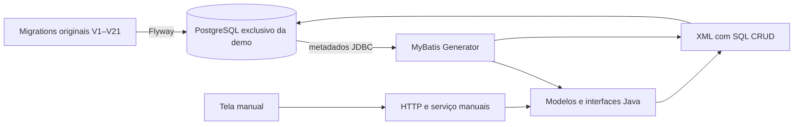

# Parte III — Database First executado no Caisora

**Escopo atual:** geração para todas as 15 tabelas de negócio, totalizando 45 arquivos, com 26 testes passando. As telas e capturas permanecem concentradas na V20. Consulte [GERACAO_COMPLETA.md](GERACAO_COMPLETA.md) para inventário e evidências da ampliação. Os logs iniciais abaixo documentam a primeira etapa, com duas tabelas.

Implementação e evidências locais de 13/11/2026. O checkout foi comparado com o remoto usando `git fetch origin` e `git rev-list --left-right --count HEAD...origin/main`: resultado `0 0`, base `82cbc96`. Não precisou de atualização. A árvore estava limpa; o trabalho foi criado na branch `feat/database-first-parte-iii`.

## Estudo do projeto

O backend está na raiz: Java 21, Maven Wrapper 3.9.16, Spring Boot 4.1.0, Spring Data JPA, Spring Security, JWT, PostgreSQL e Flyway. O frontend independente em `frontend/` usa Angular 22, Material, RxJS, TypeScript 6 e Vitest. O Compose original usa PostgreSQL `16-alpine`. Há 21 migrations versionadas. Não foi encontrada implementação anterior de Database First, MyBatis Generator ou jOOQ.

As tabelas representam organizações, usuários, clientes, embarcações, vagas, ocupações, posições, movimentações/históricos, contratos/sequências/vínculos/históricos e variabilidade. As relações usam `organizacao_id` para a organização; embarcações referenciam clientes, ocupações referenciam embarcações/vagas, movimentações referenciam usuários e posições/vagas, contratos referenciam clientes/embarcações/usuários e vínculos de ocupação. Parte dos relacionamentos está representada por `@ManyToOne`; a variabilidade usa UUID escalar para organização. As migrations e as entidades existentes foram inspecionadas e preservadas.

A V20 cria duas tabelas adequadas para a demonstração:

| Tabela | Colunas (todas NOT NULL) | Restrições |
| --- | --- | --- |
| `organizacao_modulos` | `id uuid`, `organizacao_id uuid`, `modulo varchar(50)`, `ativo boolean` | PK `id`; FK organização; UNIQUE `(organizacao_id, modulo)`; índice de organização |
| `perfil_permissoes` | `id uuid`, `organizacao_id uuid`, `perfil/modulo/acao varchar(50)`, `permitido boolean` | PK `id`; FK organização; UNIQUE `(organizacao_id, perfil, modulo, acao)`; índice de consulta |

Ambas referenciam `organizacoes(id)`; **não existe FK direta entre elas**. A V1 cria o pai; V10 adiciona slug obrigatório/único e V21 adiciona coordenadas. A demo aplica **todas as V1–V21 originais**, por Flyway, em vez de reproduzir parcialmente o DDL. O seed inclui os campos obrigatórios dessas versões. Nenhuma migration histórica ou seed do produto foi modificado.

## Técnica e escolha da ferramenta

Fluxo: **DDL real aplicado → PostgreSQL existente → introspecção JDBC pelo MBG → modelos e mappers Java/SQL → aplicação de demonstração**. O gerador não lê as entidades JPA, não extrai campos dos arquivos SQL e não recebe uma lista de atributos escritos à mão. Lê colunas e PK nos metadados do servidor. O teste de metadados também consulta `DatabaseMetaData.getColumns`, `getPrimaryKeys` e `getImportedKeys`, registrando tipos, nulabilidade e FKs em [schema-metadata.txt](evidence/schema-metadata.txt).

Escolhido **MyBatis Generator 1.4.2**, com runtime `MyBatis3Simple` e `XMLMAPPER`, compatível com Java 21/MyBatis 3.5.19 e JDBC PostgreSQL 42.7.8. A versão é fixada para reprodução. Esse runtime produz pouco código, sem dependência de Dynamic SQL, com SQL visível na apresentação. A documentação atual recomenda os runtimes Dynamic SQL para usos mais avançados; o modo simples foi escolhido conscientemente para este laboratório de CRUD básico. [Referência oficial dos runtimes](https://mybatis.org/generator/quickstart.html).

UUID é reportado como JDBC `OTHER`: duas configurações por tabela orientam o tipo Java `UUID`; um `TypeHandler` manual faz a adaptação ao driver. Isso não implementa os modelos nem o SQL. `boolean` vira `Boolean`, e `varchar` vira `String`. Os nomes de domínio foram configurados em português. Propriedades, colunas, PK e instruções SQL são geradas efetivamente pela ferramenta. O MBG não cria grafos de entidades/joins de FK automaticamente; mantemos `organizacaoId` escalar, verificamos a FK nos metadados e deixamos o PostgreSQL aplicá-la. [Escopo oficial do MBG](https://mybatis.org/generator/).

### Investigação de telas automáticas

MBG gera persistência, sem frontend. Foi avaliada a alternativa Django `inspectdb` + admin, cuja documentação descreve introspecção de banco existente e posterior integração ao admin; isso exigiria uma segunda pilha Python/Django e modelos separados dos Java gerados, além de tabelas adicionais. É viável em outro laboratório, mas não reaproveita os mappers Java exigidos aqui. Por isso não foi incorporada. [Documentação oficial dessa alternativa](https://docs.djangoproject.com/en/5.2/howto/legacy-databases/).

Não foi identificada uma solução direta de geração de telas que consuma os mappers deste laboratório sem adicionar outra camada de modelos/configuração. Optou-se pela alternativa permitida no enunciado: **tela manual**, usando o CRUD gerado via integração HTTP manual. Não se afirma que a tela foi gerada ou que geração automática de telas seja impossível em geral.

## Arquitetura e isolamento



Tudo está em `tools/database-first/`, sem vínculo de módulos/parent com o POM principal, sem novas dependências no ERP e sem alterar Angular/JPA. O servidor é o `HttpServer` do JDK 21, com Jackson para JSON. Isso permite demonstrar os mappers reais sem introduzir dependência de starter MyBatis/Spring Boot ou configuração nova no produto.

O Compose tem nome/rede/volumes próprios, banco `caisora_database_first` e usuário `caisora_demo`, com portas publicadas apenas em `127.0.0.1`. O runner recebe apenas a pasta da demo para escrita e as migrations originais em montagem **somente leitura**. Não recebe configuração ou segredo do ERP. O nome do banco é fixo; o servidor restringe hosts a `postgres`, `localhost` e `127.0.0.1` e exige marcador exclusivo no banco antes de construir as sessões.

As duas organizações fictícias são inseridas somente nesse banco. O HTTP exige autenticação local `demo`/`DBF_TOKEN`; não usa nem altera autenticação JWT do produto. O tenant é fixo no servidor, o cliente não pode fornecê-lo, e registros de outra organização recebem 404 em consulta/edição/exclusão. A listagem usa o `selectAll` gerado e filtra o resultado antes da resposta: adequado à pequena demo, sem paginação, não uma estratégia para implantar no ERP. O SQL CRUD gerado não oferece isolamento multi-tenant por si só; essa responsabilidade da integração está explícita e testada. O comportamento do produto permanece inalterado.

## Geração e arquivos efetivos

Da raiz do repositório:

```sh
node tools/database-first/demo.mjs prepare
node tools/database-first/demo.mjs clear-generated
node tools/database-first/demo.mjs generate
```

O script chama `mvn -B -ntp mybatis-generator:generate` no runner. O objetivo Maven oficial é documentado em [Running MBG with Maven](https://mybatis.org/generator/running/runningWithMaven.html). O log real registra `Connecting to the Database`, `Introspecting table public...`, geração e `BUILD SUCCESS`: [generation.log](evidence/generation.log).

Exemplos de arquivos **gerados pelo MBG** usados pelas duas telas, relativos a `tools/database-first/` (o inventário completo atual está em [GERACAO_COMPLETA.md](GERACAO_COMPLETA.md)):

```text
generated/java/br/com/caisora/dbfirst/generated/model/OrganizacaoModulo.java
generated/java/br/com/caisora/dbfirst/generated/model/PerfilPermissao.java
generated/java/br/com/caisora/dbfirst/generated/mapper/OrganizacaoModuloMapper.java
generated/java/br/com/caisora/dbfirst/generated/mapper/PerfilPermissaoMapper.java
generated/resources/br/com/caisora/dbfirst/generated/mapper/OrganizacaoModuloMapper.xml
generated/resources/br/com/caisora/dbfirst/generated/mapper/PerfilPermissaoMapper.xml
```

Cada mapper contém `insert`, `selectAll`, `selectByPrimaryKey`, `updateByPrimaryKey`, `deleteByPrimaryKey`. O SQL executável está dentro dos XML, com parâmetros `#{...}` vinculados pelo MyBatis; não é um script `.sql` para colar no `psql`. Nenhum dos arquivos gerados foi escrito ou corrigido manualmente. `generated/manifest.json` é um inventário escrito pelo script. Os [hashes iniciais](evidence/generated-sha256.json) identificam a geração original de duas tabelas; o [manifesto completo](evidence/all-tables-manifest.json) registra os 45 arquivos atuais. A imutabilidade do histórico de movimentações continua bloqueando alterações e exclusões, mesmo com os métodos gerados.

**Manuais:** configuração do MBG/Maven/Compose, scripts de orquestração, seed local, `Database`, `UuidTypeHandler`, `JsonbTypeHandler`, `CrudService`, `DemoServer`, DTO `Input`, HTML/CSS/JS, testes e documentação. O serviço usa exclusivamente os mappers gerados para o CRUD das duas tabelas; JDBC direto é usado para marcador, metadados e verificações independentes nos testes. A interface apresenta listagem, busca, inclusão e edição em formulário, exclusão com confirmação e mensagens de sucesso/erro. Marca, menu lateral e cabeçalho seguem o frontend Caisora. A separação entre geração e integração é documentada aqui, sem explicações técnicas nas telas operacionais.

## Diferença em relação ao Caisora atual

O Caisora já mantém o DDL por Flyway e entidades JPA escritas manualmente; `spring.jpa.hibernate.ddl-auto` é `validate`. Não é correto descrevê-lo como Hibernate criando tabelas automaticamente ou como Code First puro. A diferença demonstrada é a **engenharia reversa automatizada**: depois de existir o esquema, a ferramenta deriva o código de persistência dos metadados, evitando escrever campos/SQL repetitivos à mão. Os modelos gerados não substituem as entidades de domínio do ERP nem suas regras, enums e autorização.

Uma prova adicional executada altera temporariamente o banco descartável com `demo_observacao varchar(80)`, regenera e verifica `String demoObservacao` no Java, compila, remove a coluna em `finally`, regenera o esquema original e testa novamente. Veja [schema-change.log](evidence/schema-change.log). Execute `node tools/database-first/demo.mjs prove-schema` para repetir. Nenhuma migration é editada nesse processo.

## Reprodução e apresentação

Pré-requisitos e todos os comandos: [README do laboratório](../../tools/database-first/README.md). Roteiro de cinco minutos com resultados esperados: [DEMONSTRACAO.md](../../DEMONSTRACAO.md).

```sh
node tools/database-first/demo.mjs verify
node tools/database-first/demo.mjs start
node tools/database-first/smoke.mjs
```

Abra <http://localhost:8095>, usuário `demo`, senha local padrão `demo-local-123`. A configuração opcional está em `tools/database-first/.env.example`; não use credenciais do ERP. Ao terminar: `node tools/database-first/demo.mjs stop`.

## Evidências e limitações

Veja [RESULTADOS.md](RESULTADOS.md) para matriz de critérios, resultados reais, avisos e testes opcionais do produto não executados. As capturas em `evidence/` foram feitas pelo Playwright contra esta aplicação e este PostgreSQL, não são mockups. O comando `node tools/database-first/evidence.mjs` refaz banco/geração/testes/HTTP/telas e captura novamente os resultados reais.

Para inclusão no trabalho acadêmico, use [RELATORIO.md](RELATORIO.md): texto da etapa, figuras com legendas e referências às provas de execução. As capturas usam a organização fictícia **Marina Porto do Sol** e valores de módulos, perfis e ações existentes no domínio do Caisora. A apresentação é executada no módulo isolado, não no frontend de produção. A correspondência entre as operações capturadas e as leituras independentes do PostgreSQL está em [capturas-persistencia.json](evidence/capturas-persistencia.json).

O laboratório não inclui paginação, regras comerciais de enumeração, política de permissões do ERP, TLS ou implantação. Todos os valores de `varchar(50)` obedecem ao esquema, sem fingir que o banco fornece os enums Java do produto. Credenciais locais documentadas servem exclusivamente à apresentação. Chromium desktop/mobile emulado foi testado; dispositivo físico e outros navegadores não foram testados. Nenhuma operação foi realizada no banco de produção e nenhum push é necessário para demonstrar localmente.
