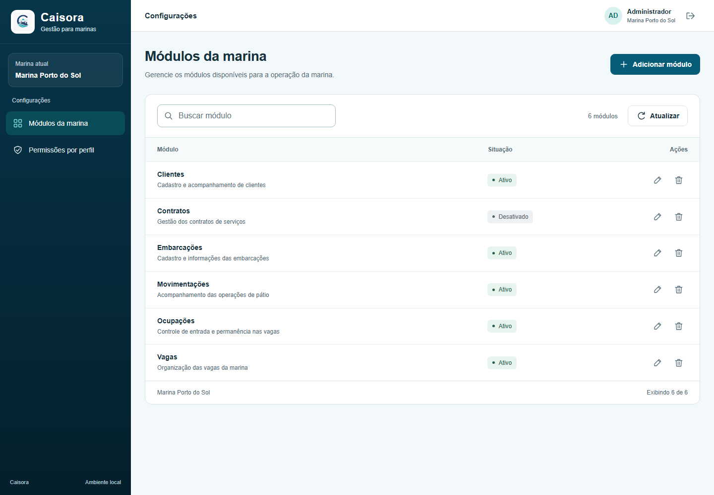
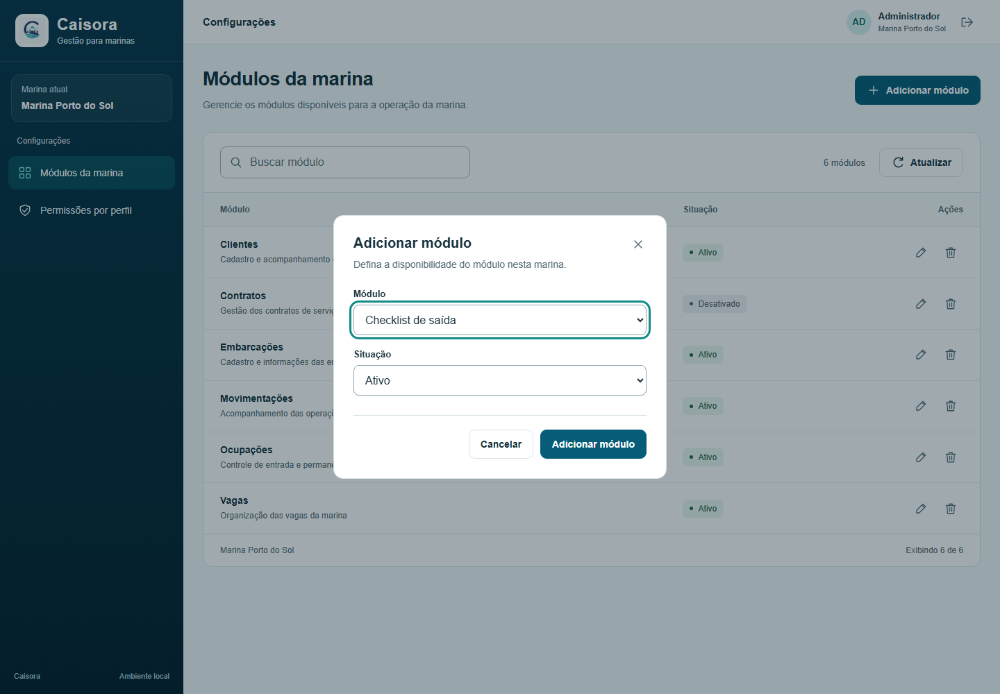
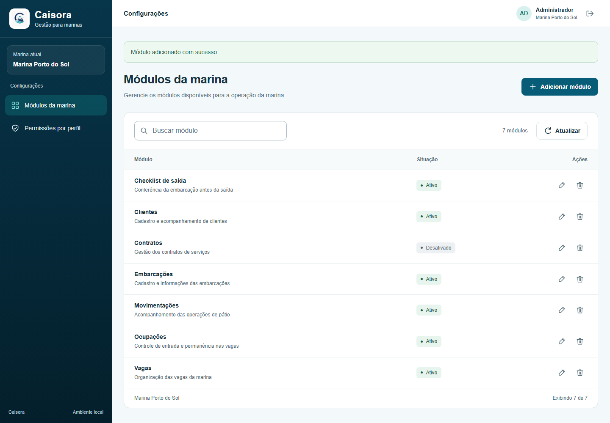
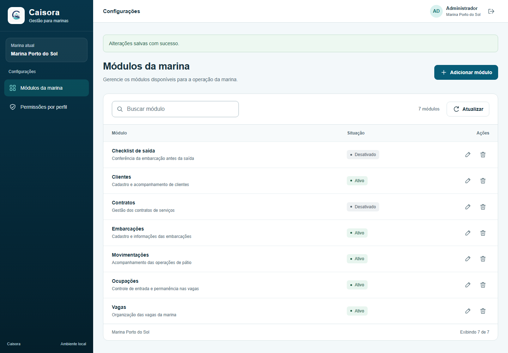
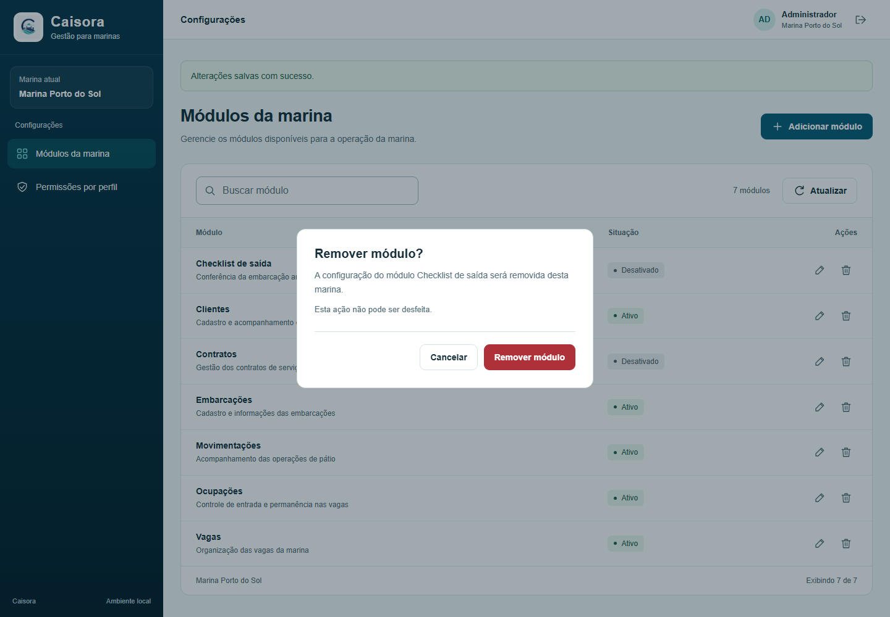
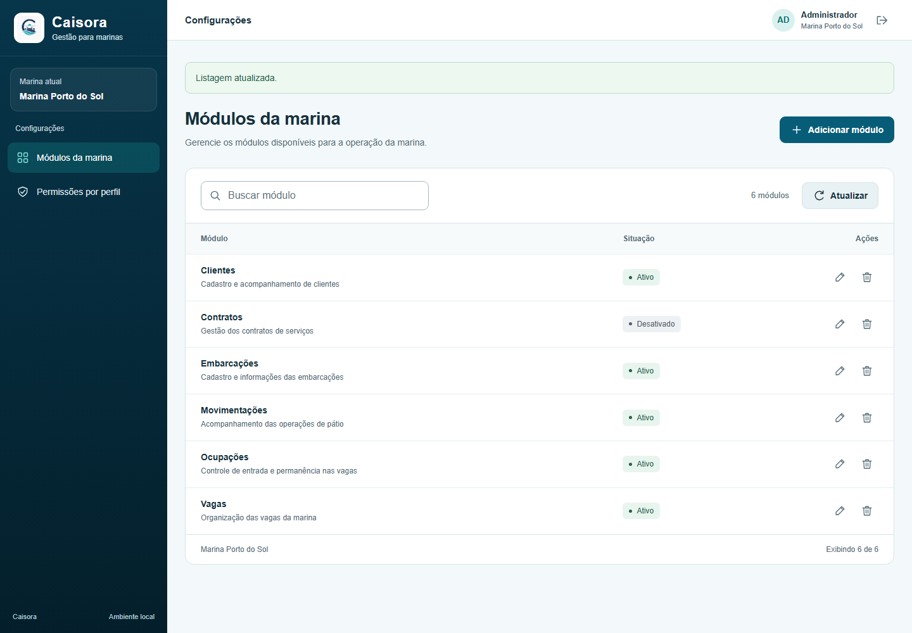
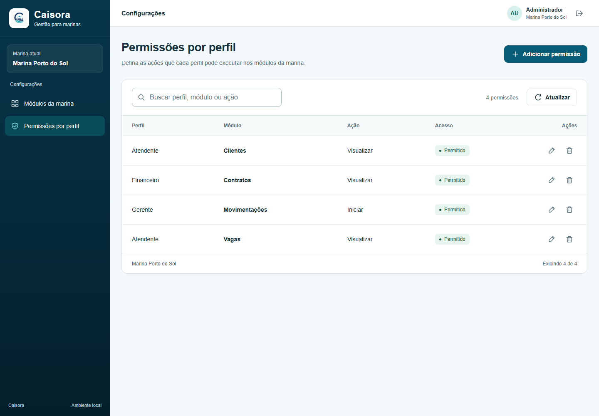
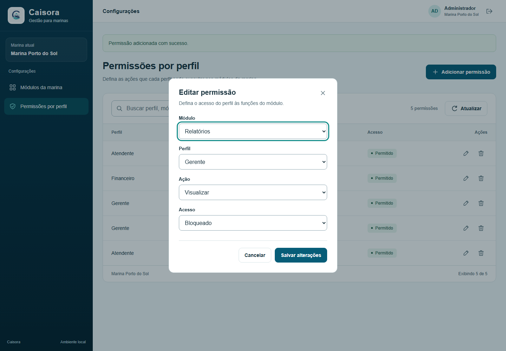
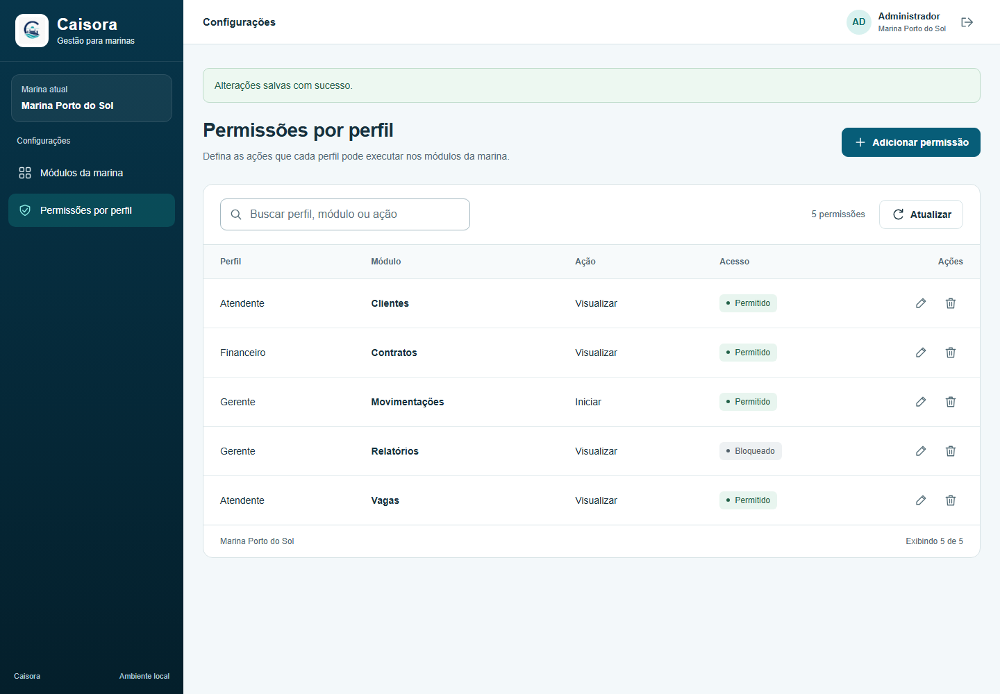

# Parte III — Database First

## Implementação

Foi desenvolvido um módulo independente de configurações do Caisora para demonstrar a geração de código a partir de um banco de dados existente. O ambiente utiliza PostgreSQL 16, Java 21 e MyBatis Generator 1.4.2. A estrutura do banco é criada pelas migrations originais do projeto, aplicadas pelo Flyway em um banco exclusivo denominado `caisora_database_first`.

As tabelas utilizadas são `organizacao_modulos` e `perfil_permissoes`, definidas na migration V20. Ambas possuem chave primária UUID, vínculo com `organizacoes` e restrições de unicidade. A primeira armazena a disponibilidade dos módulos de uma marina; a segunda define o acesso de cada perfil às ações de um módulo.

O MyBatis Generator consulta os metadados do PostgreSQL e produz duas classes de modelo, duas interfaces Mapper e dois arquivos XML com SQL de inserção, consulta, atualização e exclusão. A configuração é executada pelo comando abaixo, na raiz do repositório:

```sh
node tools/database-first/demo.mjs generate
```

Os arquivos ficam em `tools/database-first/generated/`. A integração HTTP, a validação e as telas foram desenvolvidas manualmente e utilizam os mappers gerados para acessar o banco. O backend e o frontend principais do Caisora não foram modificados.

## Telas e operações

As figuras mostram a execução real do módulo independente. A interface segue a marca e a estrutura visual do Caisora. **Marina Porto do Sol é uma organização fictícia, criada somente no ambiente local de apresentação.** Os módulos, perfis e ações correspondem aos nomes existentes no domínio do projeto.

### Figura 1 — Consulta dos módulos da marina



A listagem apresenta os módulos configurados e suas situações. O usuário pode buscar um módulo, atualizar os dados e acessar as operações de edição e remoção.

### Figura 2 — Formulário de inclusão



O formulário permite selecionar o módulo e definir sua disponibilidade. Nesta etapa, Checklist de saída está selecionado e ainda não foi salvo.

### Figura 3 — Registro inserido



Após confirmar a inclusão, a aplicação apresenta a mensagem de sucesso e consulta a listagem novamente. Checklist de saída aparece com situação Ativo, junto aos demais módulos.

### Figura 4 — Atualização persistida



A situação de Checklist de saída foi alterada de Ativo para Desativado. A nova situação exibida na listagem foi confirmada por uma consulta independente ao PostgreSQL.

### Figura 5 — Confirmação da remoção



A aplicação identifica a configuração que será removida e solicita confirmação. Cancelar mantém o registro. Confirmar executa a exclusão pelo mapper gerado.

### Figura 6 — Consulta após a remoção



Após confirmar a remoção e atualizar a listagem, Checklist de saída deixa de aparecer. Os demais módulos permanecem cadastrados.

### Figura 7 — Permissões por perfil



A segunda tela apresenta perfil, módulo, ação e acesso. O mesmo fluxo de inclusão, consulta, edição e remoção foi executado para a permissão de Visualizar Relatórios do perfil Gerente.

### Figura 8 — Edição de uma permissão



O acesso foi selecionado como Bloqueado no formulário. Esta figura registra a edição antes de salvar. A confirmação da alteração está na figura seguinte.

### Figura 9 — Permissão atualizada



Após salvar, a permissão aparece como Bloqueado. Durante esse fluxo, a listagem contém cinco permissões; após remover a permissão de Relatórios, volta a conter as quatro configurações iniciais.

## Validação

Os testes automatizados executaram conexão ao PostgreSQL, geração, compilação e CRUD completo nas duas tabelas. Também verificaram dados inválidos, chaves primárias e estrangeiras, campos obrigatórios, tamanho de texto, unicidade, autenticação e isolamento entre organizações. A suíte específica possui dez testes, sem falhas ou testes ignorados.

As capturas foram obtidas pelo Playwright durante as operações. Para os mesmos registros mostrados nas figuras, foram realizadas consultas independentes pelo `psql` após inserir, atualizar e remover. Os resultados estão em [capturas-persistencia.json](evidence/capturas-persistencia.json): situação inicialmente verdadeira, posteriormente falsa e registro ausente após exclusão.

| Verificação | Registro de execução |
| --- | --- |
| Geração de Java e SQL a partir do banco | [generation.log](evidence/generation.log) |
| Compilação e dez testes automatizados | [verify.log](evidence/verify.log) |
| CRUD HTTP e consultas independentes ao PostgreSQL | [crud-http-postgres.log](evidence/crud-http-postgres.log) |
| Banco recriado, geração e testes repetidos | [reproduce.log](evidence/reproduce.log) |
| Nova coluna SQL refletida no Java gerado | [schema-change.log](evidence/schema-change.log) |
| Operações das telas e capturas | [ui-tests.log](evidence/ui-tests.log) |

No Caisora principal, as migrations Flyway e as entidades JPA são mantidas manualmente, e o Hibernate valida o esquema existente. Nesta etapa, demonstrou-se a engenharia reversa: as classes e o código SQL foram obtidos automaticamente dos metadados do banco. As classes geradas permanecem no módulo independente e não substituem as entidades do produto.

As imagens são capturas reais do ambiente local; não representam uma implantação em produção. A interface foi desenvolvida manualmente. A geração automática implementada nesta etapa abrange modelos Java, contratos Mapper e operações SQL CRUD.
